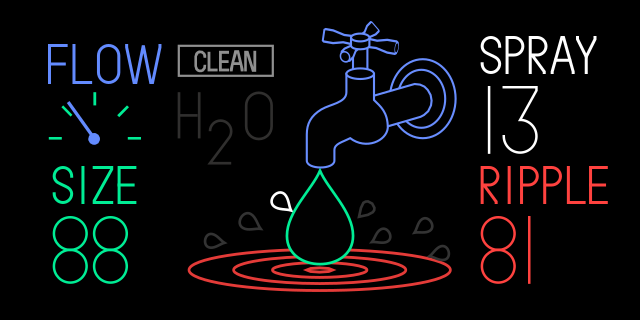

# PLOC

PLOC is a water-inspired synth for the **original Teenage Engineering OP-1** running **Hundekraft**. Play drops, bursts of spray and ripples as pitched sounds, with a tap that turns as you change FLOW.

**0.6.2 is a preview release.** The workshop verified installation on an original OP-1 running Hundekraft 3.1.4 (R246). The image above is a render; the revised layout and graphics performance still need a check on the actual OLED. Other Hundekraft versions have not been tested. The OP-1 field is not supported.

## Install

[**Download PLOC 0.6.2 for Hundekraft**](./plugins/ploc-0.6.2-install.zip?raw=true)

For an original OP-1 already running Hundekraft 3.1.4:

1. Back up your OP-1 and keep your previous plugin files if you are updating. Extract the ZIP or download [ploc.knl](./plugins/ploc.knl?raw=true) and [plocctrl.knl](./plugins/plocctrl.knl?raw=true). PLOC is version 0.6.2; its companion controller is version 0.6.1. If you already have PLOC 0.6.1 and its controller, only replace `ploc.knl`.
2. Connect the OP-1 over USB. In Firefox, open the [Hundekraft Workshop](https://hundekraft.github.io/op1-workshop/) matching your installed build. In **Your plugins**, import the files and use **Update OP-1** to review the changes.
3. Check that the plan only adds or replaces the PLOC components you selected and keeps the rest of your plugins. If the workshop proposes a full firmware update or unexpected changes, stop and check the workshop and firmware versions before proceeding. Follow the workshop prompts to apply the plan, restart, and check that the workshop reports a verified update.
4. Load PLOC from the synth browser. Existing PLOC presets from 0.4/0.5 keep their stored settings. There is no new preset bank to import.

To roll back, use the workshop to restore your previous PLOC files, or remove PLOC and PLOCCTRL if you installed them for the first time. Review the removal plan and leave your other plugins selected. See the [Hundekraft manual](https://hundekraft.github.io/op1-workshop/manual.html) for firmware setup or recovery.

## Controls

| Encoder | Turn | Shift + turn |
| --- | --- | --- |
| Blue | FLOW | Reserved |
| Green | SIZE | HEIGHT |
| White | SPRAY | QUALITY |
| Red | RIPPLE | IMPACT |

The sound engine is unchanged from 0.5.0. Version 0.6.2 adjusts the screen’s numbers, QUALITY label and ripple position.

## Source and credits

See the [build instructions](source/README.md), the [source files](source/plugins/), and the [provenance notes](source/PROVENANCE.md). PLOC is an independent plugin by Nicolas Franck Pauly, built with the Hundekraft Kennel SDK. Distributed under GPL-3.0-or-later with the firmware permission described in [NOTICE](NOTICE). [Checksums](plugins/SHA256SUMS) are provided for both binaries.
